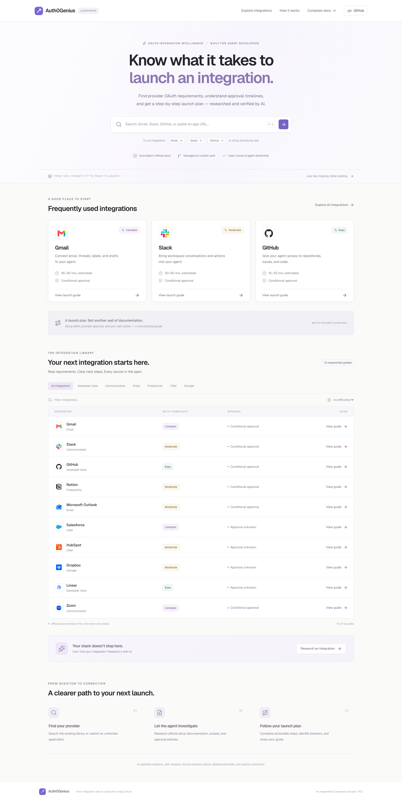
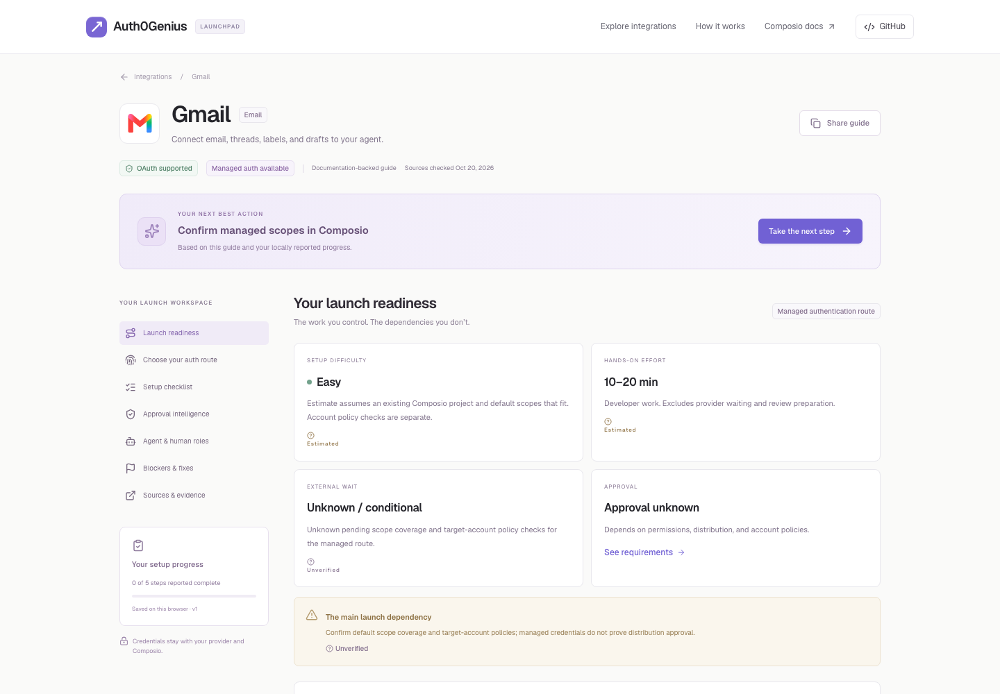

# Auth0Genius

### From integration idea to production-ready OAuth.

**Know what it takes to launch an integration before you start building it.**

Auth0Genius helps AI agent developers using Composio turn a provider name into a practical OAuth launch plan. Find the right authentication route, understand setup and approval requirements, and work through the next steps with the evidence in view.

An independent Composio product concept and working proof of concept.



## The problem

Connecting an agent to a third-party service involves more than finding an OAuth endpoint. Developers have to work out whether managed authentication is available, which permissions they need, how to test, and what changes when real users start connecting.

Those answers are scattered across provider consoles, developer documentation, consent policies, and marketplace rules. Missing a requirement can turn a quick integration into a launch blocker.

Auth0Genius brings those decisions into one workspace, with a clear next action and an honest account of what remains unknown.

## From a provider search to a launch plan

### 1. Find your integration

Search by provider name, alias, or website. Existing integrations open immediately; unfamiliar providers offer an explicit AI research action. Use `/` or `Cmd/Ctrl+K` to jump into search.

The same search accepts provider names, domains, and full URLs, including developer subdomains. For a URL, A0G validates and fetches that site, constrains identity discovery to its domain, and reuses a saved guide when its official domain matches. It pauses for confirmation when evidence is ambiguous; it does not silently substitute a similarly named result.

The initial library covers **Gmail, Slack, GitHub, Notion, Microsoft Outlook, Salesforce, HubSpot, Dropbox, Linear, and Zoom**. Gmail, Slack, and GitHub are featured and receive the deepest treatment.

### 2. Choose your authentication route

Check whether Composio-managed authentication fits before registering your own provider app. Choose custom OAuth deliberately when branding, scopes, quota, or provider requirements call for it.

Your selection changes the checklist, readiness summary, progress, launch stages, and next action. Each route keeps its own locally reported progress.

### 3. Follow your next best action

Work through provider-specific steps and see who owns each one. The launch route — **Register → Configure → Test → Verify → Launch** — keeps configuration work separate from external approval gates.

Share the saved guide URL with a teammate. They can inspect the same guidance and sources without opening the original research session.



## What the workspace helps you decide

| Your question                     | What Auth0Genius provides                                                                      |
| --------------------------------- | ---------------------------------------------------------------------------------------------- |
| Does this provider support OAuth? | A support classification, supporting documentation, and explicit gaps.                         |
| Do I need my own OAuth app?       | Managed versus custom authentication guidance, with availability left unknown when unresolved. |
| What do I configure next?         | A route-specific checklist and a next action based on your progress.                           |
| How much work will launch take?   | Hands-on effort estimates separated from provider waiting time.                                |
| Can external users connect yet?   | Testing, distribution, consent, marketplace, and security-review considerations.               |
| What could block me?              | Provider-specific dependencies, troubleshooting, and source links.                             |
| What can the agent do for me?     | A clear division between research/preparation and actions requiring your provider account.     |

## Evidence stays visible

The product is designed to remain useful when research is incomplete. Official documentation is preferred, fetched material is retained, and important claims link back to sources.

- **Reviewed source support:** an explicitly reviewed claim with relevant supporting evidence.
- **Estimated:** a reasoned estimate with assumptions, such as developer setup effort.
- **Unverified:** evidence or its interpretation is unresolved.
- **Not applicable:** an explicit, supported exemption for the selected route.

An official-looking URL, a search snippet, or model confidence does not establish that a claim is true. Live model interpretations cannot mark themselves reviewed. Unresolved classifications remain unknown, and the next action becomes evidence review rather than an unsupported setup instruction.

Checking a step records **your reported progress**. It does not configure a provider app, perform an OAuth connection, or confirm approval.

## Research an unfamiliar provider

Submit a provider name or website, optionally with the permissions your agent needs. The research flow identifies a candidate provider, searches and retrieves documentation, checks Composio guidance, investigates approval conditions, and synthesizes a structured guide.

You see actual backend stage transitions and retrieved sources. Schema and evidence checks run before the guide is saved to a persistent URL. Missing evidence and failed requests produce visible partial results or errors.

The workflow is bounded and browser-driven. It retries interrupted advancement and expired execution leases; closing every research tab can pause progress between stages. Reopening the job resumes it while the 30-minute session remains valid. A website URL is retained as the requested identity clue throughout discovery, and the resolved provider name and canonical domain appear in the research workspace once confirmed.

**Demonstrated:** a fresh Airtable run and a fresh direct-URL Figma run completed real search, retrieval, structured synthesis, validation, and persistence. The Figma request resolved `https://www.figma.com` to the design platform, fetched `developers.figma.com`, and did not switch to `figma.jp`. The guide survived an application restart and opened from a fresh browser context; a second URL submission reused the saved guide without another research run. OAuth 2.0 is documented, while managed-auth availability and approval remain unknown. See the [Figma run record](docs/live-research-direct-figma.json), [validation report](docs/validation.md), and [material-claim audit](docs/research-audit.md).

## Why ten integrations?

Ten providers demonstrate materially different launch problems: Gmail scope verification, Slack distribution policy, GitHub organization access, tenant consent, and marketplace review. The POC prioritizes useful guidance and visible uncertainty over a hundred shallow provider pages.

The focus is research, guidance, and developer progress. Provider registration, agreements, credentials, connection authorization, and approval submissions remain with the developer and the relevant services. No account system, billing, or credential vault is included.

## Try it locally

Requires Node.js **22.16+** and npm; validated on Node.js 24.12.

```sh
npm ci
# Create a local configuration without overwriting an existing .env:
cp -n .env.example .env
npm run db:push
npm run db:seed
npm run dev
```

Open **http://localhost:3000**. The ten saved guides work without research API keys. Seeding can be rerun safely.

Add real research keys only to ignored `.env` or deployment secret settings. Keep `.env.example` as a template.

| Variable                 | Purpose                                                                                    |
| ------------------------ | ------------------------------------------------------------------------------------------ |
| `DATABASE_URL`           | SQLite locally (`file:./dev.db`, relative to `prisma/`); durable PostgreSQL in production. |
| `OPENAI_API_KEY`         | Server-side provider identification and structured synthesis.                              |
| `TAVILY_API_KEY`         | Server-side web search.                                                                    |
| `NEXT_PUBLIC_APP_URL`    | The actual application origin.                                                             |
| `OPENAI_MODEL`           | Optional model override supporting Responses structured output.                            |
| `NEXT_PUBLIC_GITHUB_URL` | Optional real repository link for navigation.                                              |
| `RESEARCH_ACCESS_CODE`   | Optional shared access code to limit research spending.                                    |
| `RESEARCH_PUBLIC_ACCESS` | Set `true` for an evaluator demo with no code prompt; persistent quotas cap access at 10 research starts/day globally and 2 per IP/day. |

## Built as one application

A TypeScript **Next.js App Router modular monolith**, with React and Tailwind for the interface, Prisma for persistence, Zod for validation, and OpenAI plus Tavily for research. Local development uses SQLite; production uses PostgreSQL.

Pages and APIs live in `src/app`, workspaces in `src/components`, provider content in `src/data`, and database, research, and validation boundaries in `src/lib`. Provider guides, evidence, research jobs, and quotas persist through Prisma. Publication and job completion share a transaction; retries cannot publish the same job twice.

Research uses bounded searches, fetch deadlines, source limits, and LLM limits. Provider identity candidates come from live search, then fetched public pages are used to resolve or pause for a human choice; search snippets never become guide evidence. Explicit URLs stay on their requested site. Public demo mode has a persistent 10-start daily global cap and 2 starts per IP/day; keep it disabled for a private deployment. Retrieval accepts public HTTPS destinations, validates redirect chains, and pins DNS-checked connections. Retrieved content is treated as untrusted data, and API keys stay server-side. The app never asks for provider passwords, client secrets, or user access tokens.

## Validation

The recorded validation passed **100 unit/integration tests**, **19 development browser tests**, **19 production browser tests**, type checking, lint, and a production build. Browser coverage includes search, route switching, local progress, sharing, interrupted research recovery, saved guides, and mobile layouts. Test databases are isolated from user-created guides.

```sh
npm run typecheck
npm run lint
npm test
npx playwright install chromium
npm run test:e2e
npm run build
```

With a running app and configured keys, test real research with a provider absent from its saved library:

```sh
npm run research:live -- "Provider name" --report docs/live-research-local.json
```

The script distinguishes fresh generation from reuse; an existing guide or active job returns exit code 2. Mocked tests do not count as real research acceptance.

## Deploy with Supabase and Vercel

Use **Supabase PostgreSQL for durable data** and **Vercel for the Next.js application**. The repository includes a PostgreSQL schema and database-selection helper.

Follow the [Supabase + Vercel deployment guide](docs/deployment.md) for connection pooling, one-time schema setup and seeding, environment variables, and post-deployment checks. Local SQLite files are not deployed, and hosted persistence has not yet been validated.

## Current limits

New research produces conservative partial guides until material interpretations are independently reviewed; there is no review CMS. Provider policies and account-specific eligibility still need confirmation. Checklist progress stays in the current browser, while guide content is shareable.

Hosted PostgreSQL and a production deployment remain to be verified. The [validation report](docs/validation.md) records live-run evidence, known tooling advisories, and remaining deployment work. The [research audit](docs/research-audit.md) records provider claims, corrections, and unresolved questions.
